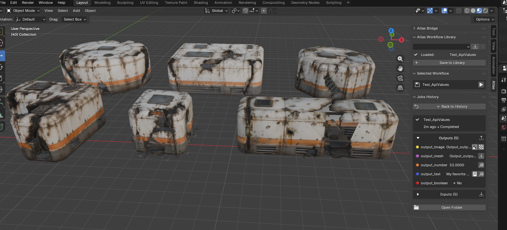
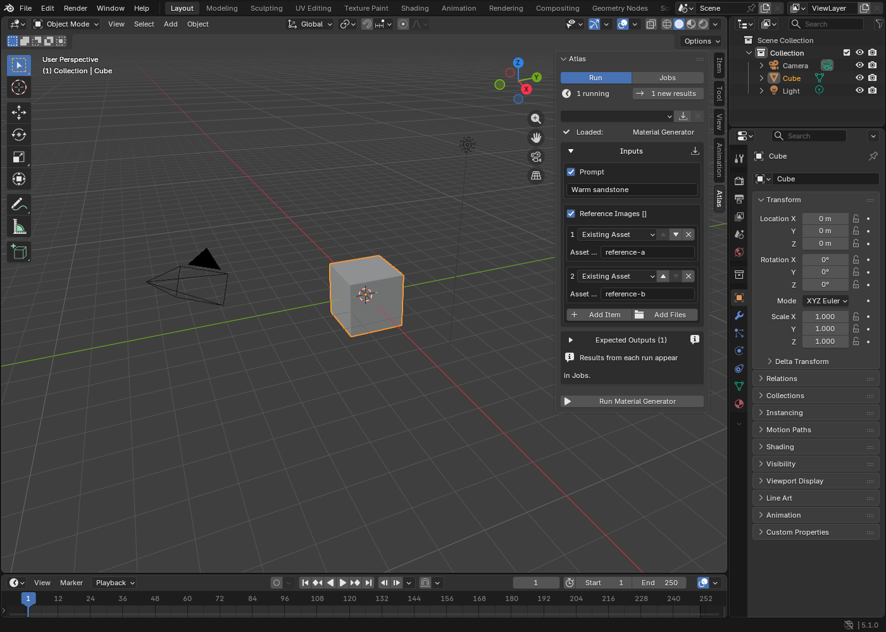
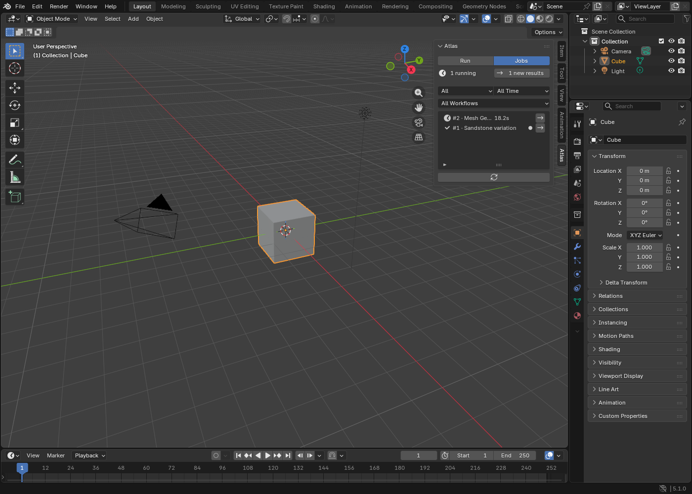
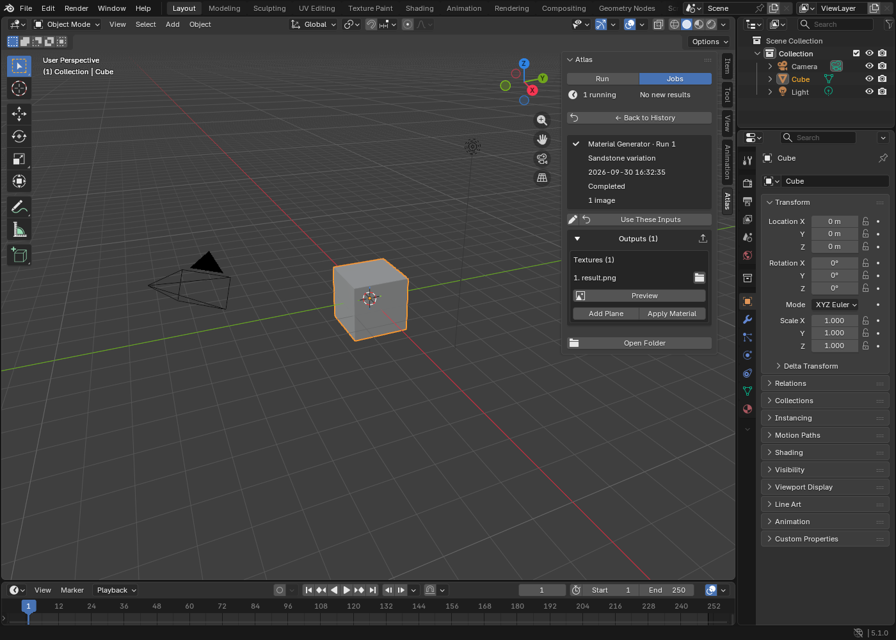
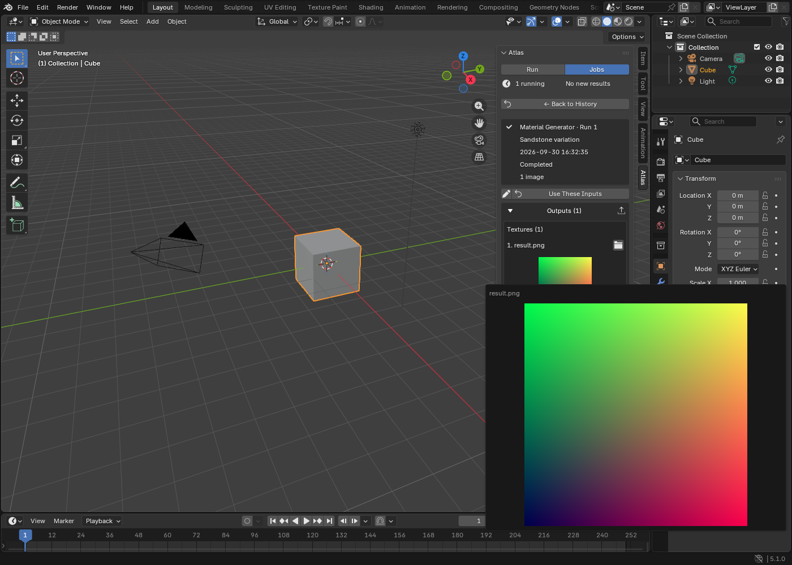
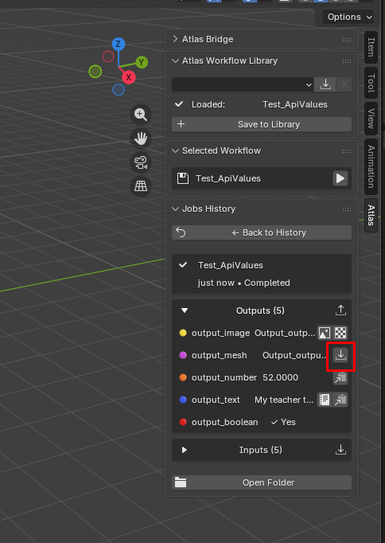
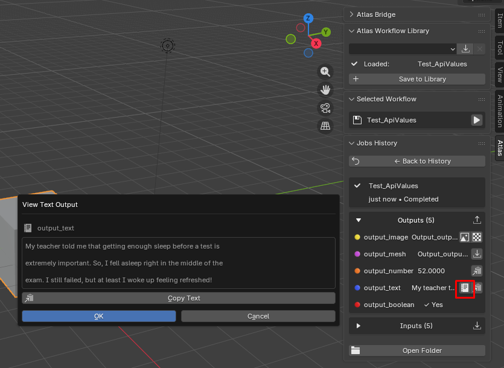
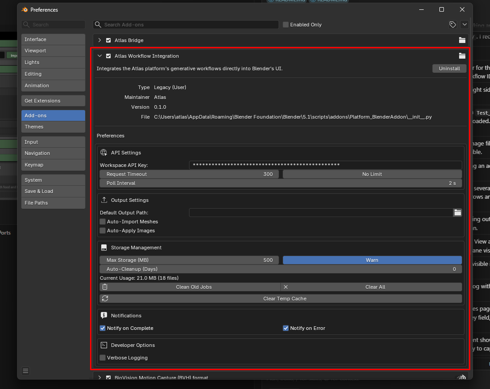
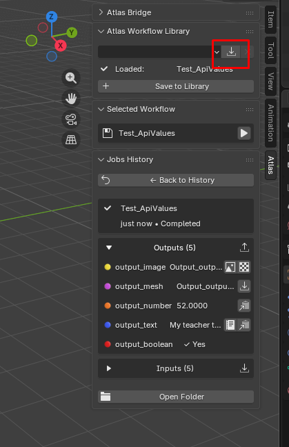

<p align="center">
  
</p>

<h1 align="center">Atlas Workflow for Blender</h1>

<p align="center">
  <strong>Run Atlas Platform workflows inside Blender — no coding required</strong>
</p>

<p align="center">
  
  
  
  
</p>

<p align="center">
  <a href="#what-this-is">What this is</a> •
  <a href="#atlas-workflow-panel">Workflow panel</a> •
  <a href="#jobs-history">Job history</a> •
  <a href="#installation">Installation</a> •
  <a href="#quick-start">Quick Start</a> •
  <a href="#settings">Settings</a> •
  <a href="#troubleshooting">Troubleshooting</a>
</p>

---

## What this is

**Atlas Workflow for Blender** connects Blender to **Atlas Platform**. You load a workflow JSON your team or Atlas provides, fill in the fields, press run, and get results back inside Blender.

The addon lives in Blender's 3D View sidebar under the **Atlas** tab. It handles file uploads, async execution, result downloads, and local job history so you can focus on creative iteration.

---

## What you can do

- **Run an Atlas workflow** from **3D View Sidebar (`N`) > Atlas**.
- **Use Blender scene data, files, or existing asset IDs** for image and mesh inputs, including ordered lists.
- **Transfer all file types in the all-types export**, including scenes, USDZ, animation, audio, video, PDF, SVG, and agent context.
- **Set primitive inputs** such as text prompts, numbers, and booleans.
- **Watch execution status and elapsed time** while the job runs without freezing Blender.
- **Review outputs later** in **Jobs**.
- **Bring results into the scene** by importing generated meshes, adding image planes, applying generated images as materials, and copying generated text.
- **Atlas Platform API v0.2** support with workspace API key auth, async polling, and version-aware upload/download URLs.

> **Note:** You need an internet connection, a workspace API key for API v0.2+ workflows, and access to Atlas Platform. Import workflow JSON exported from Atlas Platform.

---

## Atlas Workflow Panel

**Location:** open the 3D View sidebar with `N`, then select the **Atlas** tab.

One native Blender panel contains two views. **Run** prepares a workflow;
**Jobs** holds running jobs and saved results. The shared status line shows active
runs and new results in either view. Completion never changes your view or selection.

| Area | What it is for |
| --- | --- |
| **Run** | Import workflow JSON, choose a saved workflow, edit inputs, and start execution. |
| **Inputs** | Text, number and boolean controls; files, scene data and asset IDs; ordered asset lists. |
| **Expected Outputs** | Names and types the workflow can return. Actual results belong to a run in Jobs. |
| **Jobs** | Browse, filter and label runs, inspect results, and reuse inputs. |
| **Shared status** | See how many jobs are running; open an unreviewed result explicitly. |

<p align="center">
  
</p>

### Typical flow

1. In **Run**, import a workflow JSON exported from Atlas Platform.
2. Choose scene data, files or asset IDs and fill in primitive inputs.
3. Click **Run [Workflow Name]**.
4. Continue editing or switch workflows. Each workflow retains its draft during this Blender session.
5. Open **Jobs**, select the run, and click **View Results** or its arrow button.
6. Preview, import, apply, or reuse the result as needed.

After starting a run, a persistent confirmation beside the Run button shows its
number, workflow, current phase and elapsed time, with a **View Job** link. You
can keep editing or launch another run; completion does not switch views.

Drafts keep input values, omitted fields, source choices and array order. They are
separate for each workflow, API environment and version. They do not survive a
Blender restart; saved runs provide input reuse after restarting.

---

## Jobs History

**Location:** **3D View Sidebar (`N`) > Atlas > Jobs**.

Jobs is the permanent place to review runs. A run number and optional label help
identify iterations. Selecting a list row shows its timestamp and result summary;
opening it shows the full timestamp, inputs, outputs and any errors. Running job
details show the execution phase and elapsed time.

New completed or failed runs remain unreviewed until opened. That state survives
restarting Blender. Finishing another run never replaces the result you are viewing.
Older history stays readable without making every old run appear new.

| Action | What it does |
| --- | --- |
| **View Results / row arrow** | Opens that exact run. Explicit result links clear filters when needed. |
| **Delete Run** | Removes one finished run and its local files after confirmation. Output copies and remote assets remain. |
| **Stop Tracking** | Stops following an active run locally; does not cancel it on Atlas. |
| **Label Run** | Saves an optional name without changing the workflow or run ID. |
| **Use These Inputs** | Loads the run's workflow and inputs as an editable draft; does not execute it. |
| **Open Folder** | Opens the local job folder containing metadata, inputs and downloaded outputs. |

To stop following a run, select it in **Jobs** and choose **Stop Tracking** from
the list or detail view. The confirmation explains that **remote processing and
charges may continue**. Blender waits for any in-flight HTTP request to return,
then stops further uploads, submission, polling and downloads. While waiting,
the run shows **Stopping** and cannot be deleted. With request timeouts disabled,
that wait can be indefinite if the server never responds.

The saved status is **Tracking stopped**, separate from a server cancellation.
Already downloaded files remain in history and follow the Output Copy Folder
setting; stopped results are not automatically imported or applied. The run's
execution ID is retained when returned by Atlas. Tracking cannot currently be
resumed from history. No verified server-cancellation endpoint was available for
this implementation.

**Use These Inputs** offers two explicit choices: original uploaded asset IDs,
or the captured scene/file references resolved against their current contents.
Original IDs avoid re-uploading and preserve the submitted assets. Current sources
can differ from the original run and must still exist. This replaces the draft for
that workflow. Older jobs without the necessary snapshot cannot offer this action.

<p align="center">
  
</p>

<p align="center">
  
</p>

### Working with outputs

- **Image > Preview** opens a popup without adding scene objects, images or materials. A small thumbnail becomes available after previewing.
- **Image > Add Image Plane** creates a plane with the same aspect ratio as the image, assigns a texture material, and switches supported viewports to Material Preview.
- **Image > Apply to Material** creates a new material from the image and assigns it to the selected object.
- **Mesh > Import** imports the generated GLB into the scene.
- **Text > View** opens the full generated text in a dialog.
- **Copy** actions copy text or primitive values to the clipboard.
- **Use as Input** sends an output's asset ID to a compatible input of the selected workflow and returns to Run, without downloading and uploading it again. For arrays, **Use All as Input** appends the IDs in order.
- **Array outputs** offer actions for each item. **Import All Meshes** imports each asset into its own collection. Arrays stay on disk until explicitly opened; scalar auto-import preferences do not load entire arrays.
- **Other file outputs** remain available in the job folder, with asset IDs and metadata in history. If one download fails, successful files are retained and the failed item is identified.

<p align="center">
  
  <br/>
  <em>Preview first; add a plane or apply a material only when wanted.</em>
</p>

<p align="center">
  
  <br/>
  <em>Generated mesh imported into the Blender scene.</em>
</p>

<p align="center">
  
  <br/>
  <em>Full text outputs open in a compact dialog with copy support.</em>
</p>

---

## Requirements

| Requirement | Version / notes |
| --- | --- |
| **Blender** | 4.0 or newer |
| **Atlas Platform** | Access to workflows exported from your workspace |
| **Workspace API key** | Required for API v0.2+ workflows. Create one in Atlas **Workspace settings > API Keys**. |
| **Python HTTP dependencies** | Bundled with the addon |
| **Network access** | The addon calls Atlas Platform over HTTPS |

---

## Installation

1. Download `AtlasPlatform_BlenderAddon.zip` from the [latest GitHub release](https://github.com/Atlas-Design/AtlasPlatform_BlenderAddon/releases/latest/download/AtlasPlatform_BlenderAddon.zip).
2. In Blender, open **Edit > Preferences > Add-ons**.
3. Click **Install...** and select `AtlasPlatform_BlenderAddon.zip`.
4. Enable **Atlas Workflow Integration**.
5. Open the 3D View sidebar with `N`, then select the **Atlas** tab.

The addon bundles its Python HTTP dependencies, so no separate `pip install` step is required for normal use.

### Packaging a release zip for maintainers

From the addon root on Windows, run:

```powershell
scripts\package_release.bat v0.1.0
```

The script creates `dist\AtlasPlatform_BlenderAddon.zip`, a clean Blender-installable package with bundled dependencies and portable zip paths. Keep this filename for Blender installs, upload it as the GitHub release asset, and use the GitHub release tag for the version. Test that exact zip in Blender before publishing the release.

---

## Quick Start

#### Step 1: Configure your API key

Open **Edit > Preferences > Add-ons > Atlas Workflow Integration** and set:

- **Workspace API Key** — your Atlas workspace key (`atk_...`), from **Workspace settings > API Keys** on the platform.
- Or leave the field empty and set `API_KEY` before launching Blender.

API v0.2+ workflow runs fail immediately if no key is configured.

<p align="center">
  
  <br/>
  <em>Addon preferences for API key, timeout, polling, output behavior, and storage.</em>
</p>

#### Step 2: Open the Atlas tab

Open a 3D View, press `N`, and choose the **Atlas** tab.

#### Step 3: Import a workflow

1. Click the import button in **Run**.
2. Choose a workflow JSON exported from Atlas Platform.
3. The workflow appears in the library and its inputs appear in **Run**.

<p align="center">
  
  <br/>
  <em>Import a workflow JSON exported from Atlas Platform.</em>
</p>

#### Step 4: Configure and run

1. Fill in inputs.
2. Click **Run [Workflow Name]**.
3. Wait for the job to complete.
4. Open **Jobs History** and use output actions to bring results into your scene.

---

## Settings

Open **Edit > Preferences > Add-ons > Atlas Workflow Integration**.

| Setting | Default | Description |
| --- | --- | --- |
| **Workspace API Key** | Empty | Bearer token for Atlas Platform (`atk_...`). Required for API v0.2+ workflows. |
| **Request Timeout** | 300 seconds | Per-request HTTP timeout. Set to `0` or enable no limit for long requests. |
| **Poll Interval** | 2 seconds | How often the addon checks async job status. |
| **Output Copy Folder** | Empty | Optional extra file copies in a unique folder per run. Job History always retains originals. The effective destination is shown below the field. |
| **Auto-Import Meshes** | Off | Import single mesh outputs into the current scene; arrays stay manual. |
| **Auto-Apply Images** | Off | Apply single raster outputs to the object active at completion; arrays stay manual. |
| **Storage Warning** | 500 MB | Warning threshold for local job history storage, not a hard cap. `0` disables it. |
| **Warn** | On | Report an exceeded storage threshold when starting a run. |
| **Manual Cleanup Age** | 0 | Starting age for the Clean Old Jobs dialog; `0` uses 30 days. Nothing is deleted automatically. |
| **Notifications** | On | Independently enable completion/error reports. New-result markers and history remain available when muted; validation errors remain visible. |
| **Verbose Logging** | Off | Extra console output for troubleshooting. |

The former **Default Output Path** setting is now **Output Copy Folder**. A custom
folder is captured when the run starts, so changing it affects subsequent runs.
Copies use `<folder>/<workflow>/<timestamp>_<job-id>/`; **Open Output Copies** in
the job details opens that location. Blank means no extra copies. `//` paths are
relative to a saved `.blend`. Invalid/unwritable destinations fail before the API
run; later copy failures are recorded while the original results stay in history.
Existing files are never overwritten by the copy step. Primitive values stay in
`job.json`; the optional folder receives file outputs only.

**Clean Old Jobs** and **Clear Finished Jobs** delete finished history records
and their stored files after confirmation. They preserve queued/running jobs and
exported copies. Storage usage counts Job History, not the extra copies.

Keys are sent as `Authorization: Bearer <key>` on upload, execute, status, and download requests.

---

## Workflow JSON Files

Workflow JSON files describe the Atlas API endpoint, input controls, and expected outputs. In normal use, your team or Atlas provides these files.

Example workflow templates live in `examples/`. Replace placeholder `api_id` values with real Atlas workflow API IDs before running them.

Supported types:

| Type | Blender UI | Output behavior |
| --- | --- | --- |
| `boolean` | Checkbox | Shows Yes/No and stores value in job history. |
| `number` | Number field | Shows numeric value and copy action. |
| `string` | Text field | Shows preview, full-text dialog, and copy action. |
| `image` | Scene image or local image file | Downloads image output, supports View and Apply. |
| `mesh` | Scene object or local GLB/GLTF file | Downloads GLB output and supports Import. |
| `jpeg`, `webp`, `tga`, `tiff`, `avif` | File or asset ID | Retains encoding; supports raster View and Apply. AVIF actions require Blender 5.1+. |
| `exr` | Blender image, file or asset ID | Single-layer Blender image export preserves linear float values and alpha; downloaded images support View and Apply. Multilayer EXR is supported as unchanged file transfer. |
| `scene` | Current scene snapshot, file or asset ID | Append a chosen collection or open the result in a separate Blender process. |
| `usdz` | Root object and descendants, file or asset ID | Import with textures extracted beside the result in durable job storage. |
| `rig_animation` | Armature with active action and frame range, file or asset ID | Export bound meshes and skinning; import returned GLB rigs and clips. |
| `audio`, `video` | File or asset ID | Add to the Sequencer with an explicit frame and channel. |
| `svg` | File or asset ID | Import path geometry as curves when the SVG importer is available. |
| `agent_context` | File or asset ID | Read-only, paginated JSON view; linked attachments stay references. |
| `pdf` | File or asset ID | Save, reveal and reuse the asset. |

Every file input accepts an **Existing Asset** UUID. `agent_context` is a stored file asset: provide its UUID or upload its file, never inline conversation JSON. File outputs accept objects containing `fid`, a download URL and metadata; legacy UUID responses also work. The plugin sends only UUIDs when chaining results.

Inputs marked `isArray` expose **Add Item**, **Add Files**, remove and reorder controls. Image and mesh lists can mix Blender data, files and existing asset IDs; each mesh row exports a separate GLB. Empty lists and duplicate IDs retain their meaning.

The **Provide value** checkbox controls omission. Disabling it leaves the field out of the request; Atlas applies optional defaults or returns a required-input error. Explicit per-input `required` flags are respected. When the workflow export omits that metadata, the plugin leaves validation to Atlas. No OpenAPI file is needed.

Downloads preserve the returned format and stream to disk. Workspace credentials are restricted to the configured API origin; foreign download URLs use the canonical asset-ID endpoint, and cross-origin redirects are rejected.

Native behavior is checked in Blender 4.0.2 and 5.1. Unknown future types remain visible; unsupported inputs must be omitted only when the workflow allows it.

The supplied all-types development workflow was also verified live, including all 21 output parameters and a subsequent run using returned UUIDs. That deployment returns legacy UUID strings; asset-object response support is covered by local fixtures. Uploads include explicit MIME types, and recognized file signatures correct stale download MIME labels.

### Scenes, animation and media

- **Scene snapshot:** copies the current scene, including unsaved image edits, and packs its dependencies in an isolated background Blender process. The active file, selection and images stay unchanged. Linked libraries must first be made local. Missing files and dependencies Blender cannot pack, such as external caches or video strips, produce an error; use a prepared scene file for those workflows. Snapshot packaging can take longer for large scenes.
- **Scene results:** **Append Collection** adds the collection you choose to the current scene. **Open in New Blender** opens another process with automatic scripts disabled. Scene compatibility still depends on the Blender version that created the file.
- **USDZ:** choose a root object; its descendants are exported with textures. Imported textures are copied to a unique folder beside the downloaded asset, so they survive temporary-file cleanup. Support is limited to Blender's USD capabilities.
- **Animation:** select an armature, assign the desired action in Blender, and set the start/end frames. The addon includes meshes bound through Armature modifiers and exports the active actions of that selection. NLA tracks on the armature are temporarily muted, then restored. This is an interchange operation; it does not retarget rigs.
- **Audio/video:** **Add to Sequencer** asks for a start frame and channel. An overlapping clip is rejected so existing strips stay in place. Video adds a movie strip; add audio separately. Supported decoding depends on the Blender build. Keep the job's files while the sequence uses them.
- **SVG:** **Import Curves** handles the installed SVG importer's supported path geometry, not full browser rendering. When the importer is unavailable, the downloaded file remains usable.
- **Context:** **View Context** displays JSON up to 4 MiB as read-only pages. It never executes stored instructions or fetches linked attachments. Scene and context results can each be reused as inputs for the next run.

API v0.2 workflows require `version`, `api_id`, `base_url`, `name`, `inputs`, and `outputs`.

---

## Data Stored Locally

The addon creates local folders while you work:

```text
atlas_workflows/      Saved local workflow library
atlas_jobs/           Job history, job.json files, inputs, outputs
atlas_workflow_*      Temporary upload/download folders in the system temp directory
```

These folders are local user data and are intentionally ignored by Git.

---

## Repository Layout

Release validation steps, manual cases and expected results are in
[TESTING_GUIDE.md](TESTING_GUIDE.md). Automated commands are summarized in
[tests/README.md](tests/README.md).

```text
AtlasPlatform_BlenderAddon/
  __init__.py          Blender addon entrypoint
  atlas/               Runtime implementation modules
  examples/            Sanitized workflow JSON templates
  icons/               Custom icon assets
  README.md
  LICENSE
```

Runtime implementation modules are intentionally grouped under `atlas/`; `__init__.py` stays at the repository root because Blender uses it as the addon entrypoint.

---

## Troubleshooting

### Authentication

#### API key required / run blocked before it starts

**Possible causes:**

- No API key in addon preferences.
- API v0.2+ workflow but empty key field and no `API_KEY` environment variable.

**Solutions:**

1. Set **Workspace API Key** in addon preferences, or set `API_KEY` before launching Blender.
2. Create a new key in Atlas **Workspace settings > API Keys**.
3. Confirm the workflow JSON belongs to the same workspace as the key.

#### HTTP 401 or 403

**Possible causes:**

- Invalid or revoked API key.
- Workflow JSON from a workspace your key cannot access.

**Solutions:**

1. Re-copy the key from Atlas.
2. Re-import a workflow JSON exported from your workspace.
3. Ask your team to confirm workspace access.

### Common issues

| Problem | What to try |
| --- | --- |
| HTTP client import fails | Reinstall the addon from a complete release zip so the bundled `vendor/` folder is included. |
| Workflow JSON will not load | Confirm it includes the required fields and supported parameter types. |
| Input file is missing | Re-select the image or mesh file in the input row. |
| Image output is not visible | Use **Preview** to inspect it, **Add Image Plane** to place it in the scene, or **Apply to Material** for the active object. |
| Apply image does nothing | Select an object with material slots, then click **Apply** again. |
| Mesh did not import | Confirm the output file exists in the job folder and is GLB/GLTF. |
| Job history looks stale | Click refresh in **Jobs History** or rerun the workflow. |

---

## License

This project is licensed under the **MIT License**. See [LICENSE](LICENSE).

---

<p align="center">
  <strong>Built by the Atlas team</strong>
</p>
